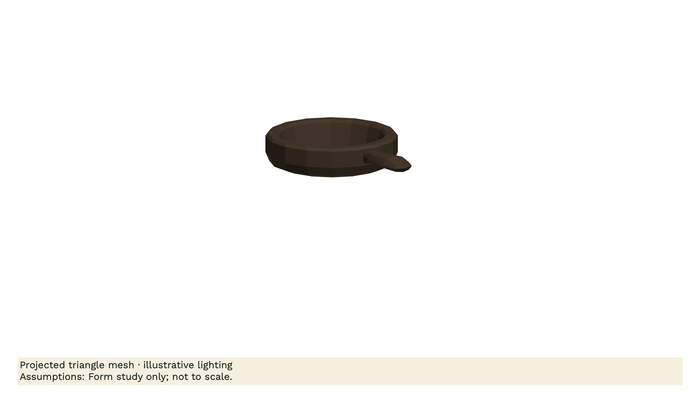
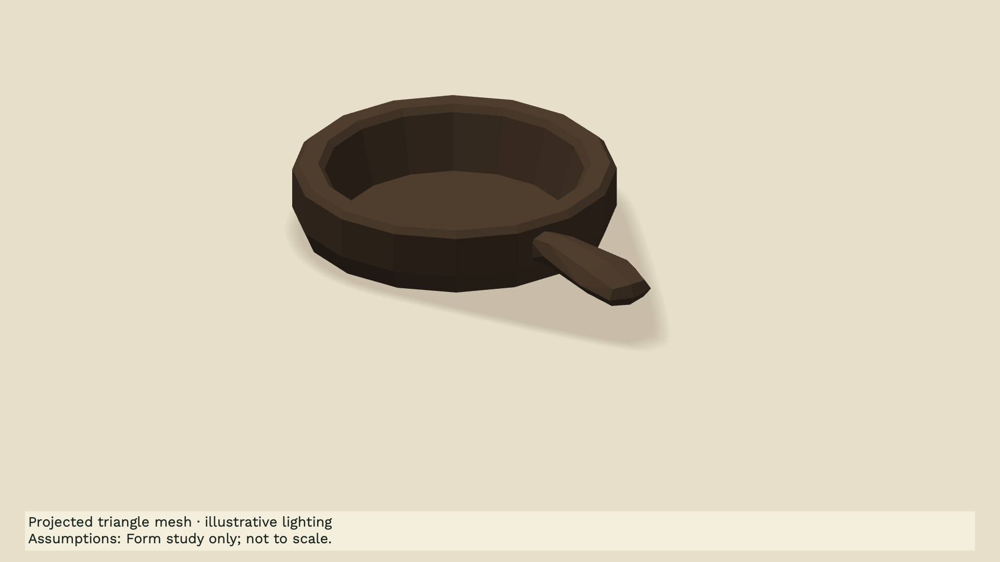
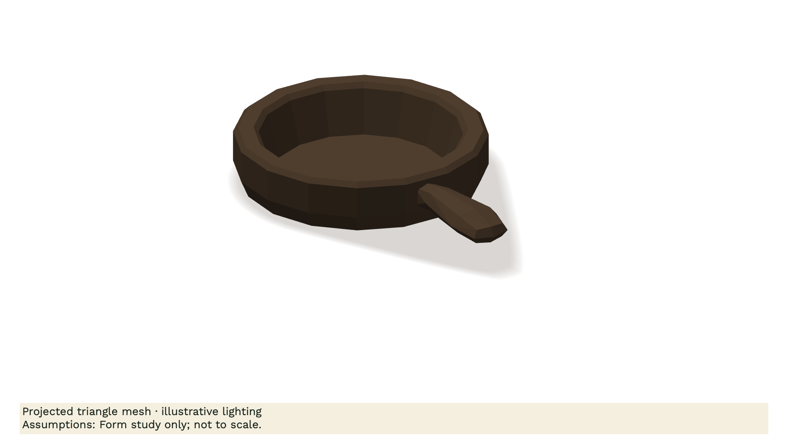
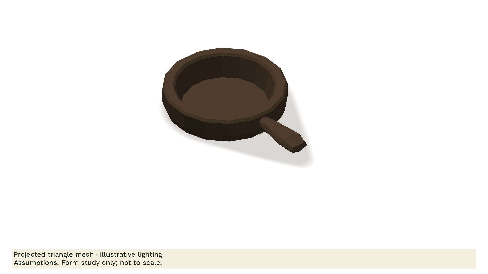
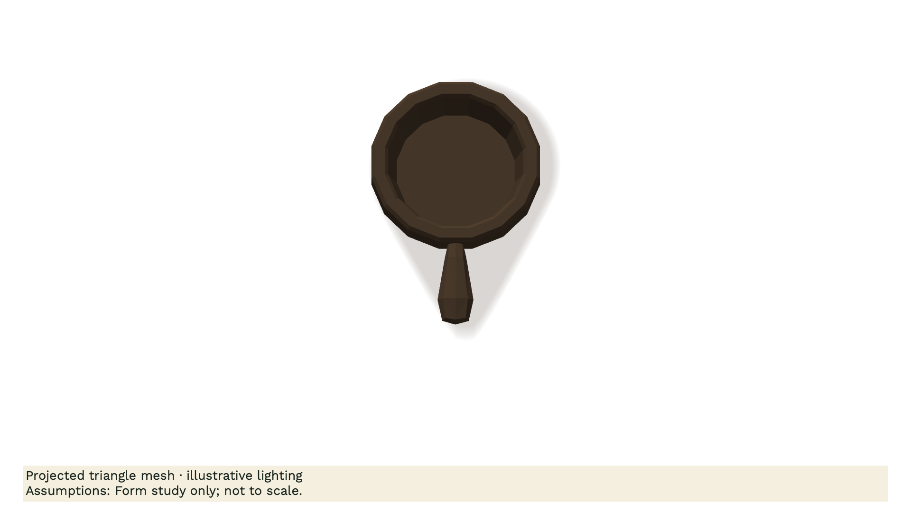

# Reusable pan studio: verified form study

The same downloaded KayKit Pan A geometry now uses a fitted camera, matte Sage & Oat material, softened contact shadow and deterministic motion on twos. This is a pan form study based on the existing Pan Seasoning subject. It does not replace that film's conceptual coating/slab explanation or reproduce Katie's handwritten artwork.

| Earlier native rig, same geometry | Reusable craft rig, shown over oat |
| --- | --- |
|  |  |

The source model and atlas remain pinned to the creator's CC0 release. The atlas is retained but replaced visually by the declared native matte palette. These pictures are our own native renders, not copied marketplace example renders.

| Hero | Inspection | Overhead |
| --- | --- | --- |
|  |  |  |

On October 28, 2026, **41 native tests in six suites passed** on source `fe26095`, after rebasing onto integrated Clauto candidate `f57e6bf`. The standard-library preparation suite also passed all 17 tests. The saved [proof manifest](../studio/evidence/pan-study-2026-10-28/proof.json) includes source identity, exact hashes, producer, immutable movie/revision locations and the bounded runner's completion receipt.

The real prepared request was imported through the native controller into a disposable project, exported through the existing revision service, reopened, and imported again without creating another scene or replacing the current revision. Tests also exercised interrupted exports, newer edits, source substitution, actual saved-cut composition, missing font glyphs and corrupt input refusal. Independent renders produced identical raster and PNG bytes; odd/even frame pairs matched. This is a same-host result, not a cross-GPU or cross-OS bitwise guarantee.

The resulting movie contains **96 frames at 1920 × 1080, ProRes 4444, duration 96096/24000 seconds (4.004 seconds)**. Every frame decoded at its expected timestamp. Maximum first/last-frame alpha error was zero. The movie is 32,312,135 bytes; its exact location and SHA-256 are in the manifest.

An independent reviewer inspected the first, quarter-motion extremes and final poses, all three camera templates, and straight-alpha edges over both oat and a [contrasting background](../studio/evidence/pan-study-2026-10-28/after-0000-on-contrast.png). The initial shadow fringe was corrected using half-float blending and preservation of straight-alpha base pixels. The revised grounding, silhouette, framing and concise caveat passed that bounded still-image review. Final editorial and scientific acceptance remains separate.

The native source and headless workflow are verified. Product GUI interaction and importing the FCPXML into the Final Cut application were not part of this proof. The scene remains editable in Clauto; each exported graphic movie has flattened internal pixels. Existing live projects and original historical Pan assets were not changed.

Follow [DEMO_STUDIO.md](DEMO_STUDIO.md) to discover, prepare and import the same example without rebuilding the environment. The preparation receipt deliberately continues to say `renderVerified: false`: preparation cannot certify a later native render. Consult the matching native proof for that distinct result.
